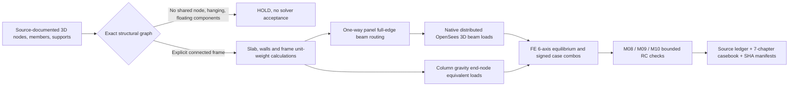

# R6.22 — Independent structural geometry and material-load engine

**State:** first-party executable **bounded** source-to-OpenSees gravity pipeline, not a whole-building structural approval or released software milestone. The original R6.20 objective remains: derive answers independently, rather than match ETABS.

## Input → result chain



No native ETABS21 object, E2K export, legacy reaction or numerical target is required.

## Input source contract

`jp.structural.r6p22.independent_geometry_input.v0.1`:

- `model`: already-normalized canonical model with explicit node IDs, floor elevations, 3D coordinates, members, sections, material IDs and support restraints. No nearest-neighbor automatic structural joins. Only horizontal BEAM and plumb COLUMN members with rectangular sections are admitted in this first stage.
- `physical_materials`: stable material ID, positive source-declared unit weight in kN/m³ and source/assumption citation. This is independent of elasticity `E`; both must come from documented material assumptions.
- `panels`: stable panel source ID, **four corner node IDs** on one axis-aligned horizontal rectangle, slab thickness (m), material ID, additional finish kPa, imposed kPa, **explicit** assumed live seismic-mass participation, declared `span_direction` X or Y, *two physical full-edge beams* and source citation.
- `walls`: wall IDs with real receiving beam ID, height, thickness, material, gross wall-length derived from that beam, explicit opening area and source citation. Negative masonry opening or more-than-full-area openings fail.
- `include_frame_self_weight: true`: mandatory for this bounded pipeline, so no silent duplicate/user-injected frame selfweight.
- `additional_cases`: optional separate source-identified lateral load cases (do not infer site hazard).
- `combinations`: explicit algebraic combinations, not yet automatic NBC-governing completeness.
- `design_bindings`: explicit same-model beam, column and joint design data/source refs; never silently invent bars, footing or hierarchy.
- `provenance`: source/assumption IDs for geometry, materials, supports, loads, reinforcement, design-code basis. Actual project-source cases remain unverified until independently reviewed.

One-way load-routing assumption is **not a physical shell FE model**. Two-way slabs, cantilevers, openings in a panel, non-rectangular slabs, transfer structures, inclined frames, releases and offset members remain HOLD until separate physically justified algorithms are implemented. Nonzero structural panels require a documented support model, not an aspect-ratio-only guess.

## Exact formulas and independent synthetic hand check

All units are SI; source material unit weights are explicitly supplied, not hard-coded project values.

- Slab pressure = thickness [m] × material unit weight [kN/m³] [kPa].
- Slab/finish/imposed load = actual supported plan area [m²] × declared pressure [kPa].
- Opposite full-edge one-way simply supported beam line load = panel pressure × support spacing / 2 [kN/m].
- Wall weight = (wall height × supporting beam length − wall opening area) × wall thickness × unit weight; uniform equivalent beam load = weight / beam length.
- Rectangular horizontal beam selfweight = width × depth × length × unit weight, **native uniform beam element load**.
- Plumb column gravity selfweight = width × depth × length × unit weight. This stage puts **half** at each end as a nodal gravitational action; the total resultant and global plan first moments are exact, but **the continuous axial force distribution is not modeled exactly**. A genuinely distributed vertical-column body-force implementation is a later dependency.
- Source → applied force, global X/Y first moments and FE global Fx/Fy/Fz/Mx/My/Mz equilibrium must balance. Passing these does **not** prove correct slab stiffness or strength.

Synthetic four-column frame reference, **not the actual G+1.5 design**:

| Gravity source | Manual kN |
|---|---:|
| 4×3 m slab, 0.12 m × 25 kN/m³ | 36.00 |
| Finishes, 1.5 kPa | 18.00 |
| Imposed load, 2.0 kPa | 24.00 |
| Masonry wall, 4 m × 2.8 m, minus 1.5 m² opening, thickness 0.15 m × 18 kN/m³ | 26.19 |
| Horizontal RC beam selfweight, 14 m × 0.30 × 0.45 × 25 kN/m³ | 47.25 |
| 4 columns, 3 m × 0.40 × 0.50 × 25 kN/m³ | 60.00 |
| **Total independent gravity** | **211.44** |

A seismic *eligible-weight ledger* is calculated as 194.64 kN (DL 187.44 + assumed 30% of 24 kN imposed). This is **not** an approved dynamic FE mass model nor an official occupancy factor. Replacing the assumptions must deterministically change the result.

## Commands and files

Install the existing Python/OpenSees test environment, then run:

```bash
python scripts/build_r6p22_independent_geometry_sar.py --reference --output-dir build/r6p22-independent-geometry
python -m pytest -q tests/test_r6p22_independent_geometry_gravity.py
```

A real-source dataset must be stored and run *outside the public checkout*:

```bash
python scripts/build_r6p22_independent_geometry_sar.py \
    --input /secure/project/source-geometry.json \
    --output-dir /secure/project/r6p22-report
```

Output:
- `r6p22-geometry-loadpath.json` — actual load-source and connectivity audits, frame element load records, OpenSees source/result SHA and full casebook.
- `r6p22-geometry-loadpath-routes.csv` — individual material/panel/beam line source to FE element mapping.
- `r6p22-geometry-loadpath.html` — summary, individual member load paths and open link into `casebook/independent-sar.html`.
- `casebook/independent-sar.json/.html/.csv/.manifest.json` — signed I/J member actions and bounded RC checks from **the same OpenSees model**.
- `r6p22-geometry-loadpath-manifest.json` — exact SHA256 file receipts, verified by CLI.

## Remaining engineering gates

1. Create private drawing-grounded building geometry and verify actual floor and foundation choices. This reference model is deliberately synthetic.
2. Provide real multi-floor shell/diaphragm topology and conforming mesh, two-way/cantilever slabs, stiffness and serviceability, releases, transfer elements and vertical-column distributed body loads.
3. Independently derive complete site-specific NBC seismic/wind/mass/irregularities/P-Delta/ULS/SLS input cases and combined signed effects.
4. Complete all applicable member, slab, staircase, foundation/soil and RC ductile detailing and verify the historical adverse **F3 NOT SAFE IN ONE WAY SHEAR** independently; do not silently flip it to PASS.
5. Produce full project SAR/PDF from source-verified computations, run independent numerical, source and document QA, then consider a **software milestone** separately from professional engineering approval.

No tag, no main/Pages release and no construction approval are authorized by R6.22.
